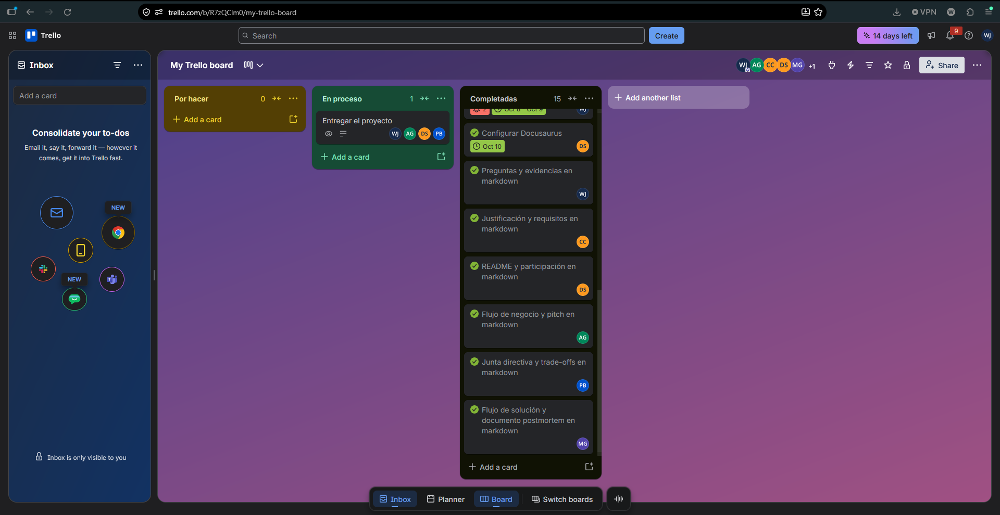
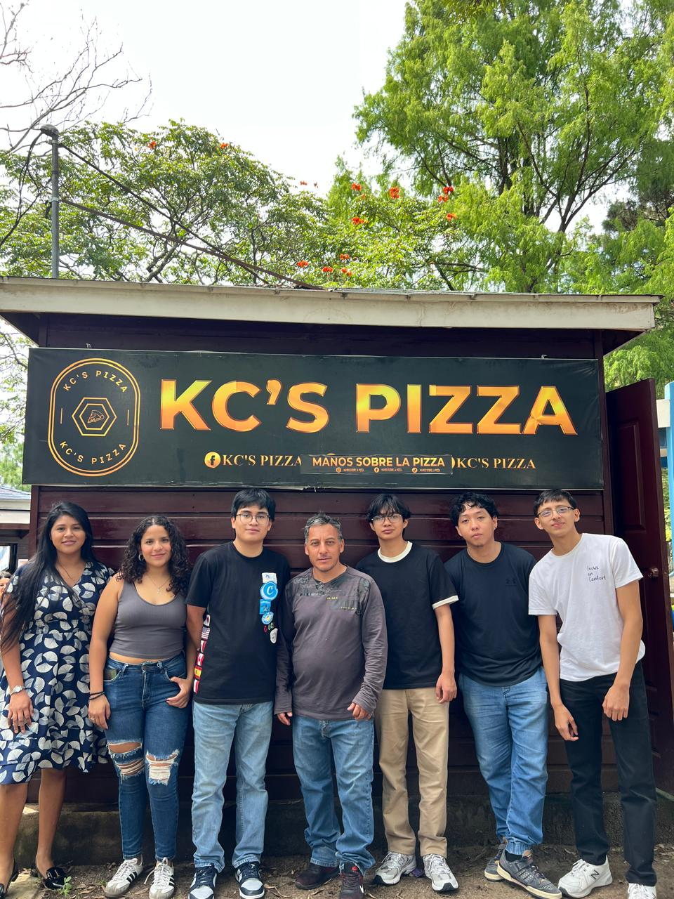

# Evidencias del Trabajo de Campo

En esta sección se documentan las fotografías y recursos utilizados como evidencia de la recolección de información y organización del proyecto.

### Organización del Equipo

A continuación, se muestra el tablero de Trello utilizado para la gestión de tareas del proyecto, donde se evidencia la asignación y progreso de las actividades.

[🔗 Ver el tablero de Trello aquí](https://trello.com/invite/b/6ad01e214802d9d6a711f816/ATTI8acd31ddf6ac3990c1145cc71fdbba0fEB0B6BAB/my-trello-board)

### Visita al Negocio

La siguiente fotografía documenta la visita del equipo al establecimiento "KC'S PIZZA", donde se llevó a cabo la entrevista con el propietario para la recolección de información.

### Audio de la Entrevista

A continuación, se encuentra el enlace de referencia al audio completo de la entrevista realizada durante el trabajo de campo:

<audio controls>
  <source
    src="/CA_2S26_G1/documentos/entrevista.mp3"
    type="audio/mpeg"
  />
</audio>